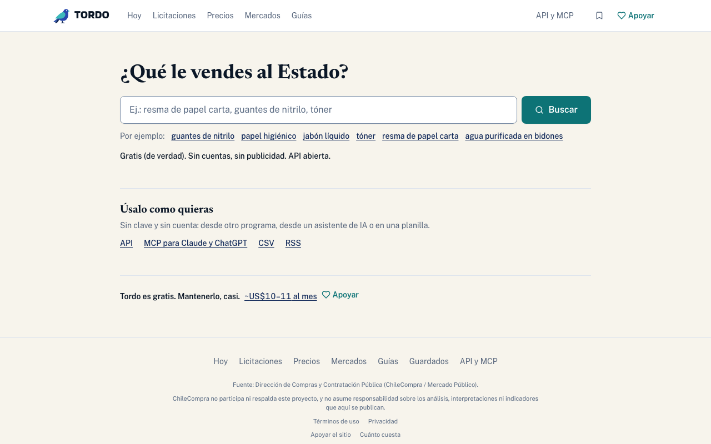

# TORDO

**Las compras del Estado de Chile, en abierto y gratis.** Busca licitaciones abiertas y Compras
Ágiles, mira a qué precio se ha comprado un producto, quién gana en un rubro y cómo compra cada
organismo. Sin cuentas, sin planes, sin anuncios.

<https://tordo.cl> · API y servidor MCP: <https://tordo.cl/abierto>

## Qué hay aquí

| Carpeta | Qué es |
|---|---|
| `frontend/` | El sitio: Next.js 16 (App Router), TypeScript, Tailwind, TanStack Query |
| `backend/` | La API de sólo lectura y el servidor MCP: FastAPI, SQLAlchemy, PostgreSQL |
| `etl/` | La ingesta desde la API y las descargas masivas de Mercado Público, y los análisis (Polars) |
| `infra/` | Docker Compose para desarrollo |
| `docs/` | Decisiones, despliegue y especificaciones. `docs/README.md` dice qué documento está vigente |

`CLAUDE.md` describe el estado real del código y sus reglas, con el porqué de cada una. Es la
mejor puerta de entrada.

## Cómo correrlo

Necesitas Python 3.11–3.12 con [`uv`](https://docs.astral.sh/uv/), Node 20+, Docker y `make`.

    cp .env.example .env
    make setup        # dependencias y hooks
    make dev-up-d     # Postgres y la API en Docker
    make migrate      # el esquema
    make front-dev    # el sitio en http://localhost:3000

`make help` lista todos los comandos. `make ci` corre en local lo mismo que el CI;
`make e2e`, la pila entera con Playwright.

Para traer datos hace falta un ticket propio de la API de Mercado Público
(<https://api.mercadopublico.cl>) en `MERCADO_PUBLICO_TICKET`; ver «Comandos» en `CLAUDE.md`.

## Licencias

- **Código: GNU Affero General Public License, versión 3 o (a tu elección) cualquier versión
  posterior** (`AGPL-3.0-or-later`; el texto está en [`LICENSE`](LICENSE)). Puedes usarlo,
  estudiarlo y modificarlo. Si sirves una versión modificada como sitio web, tienes que publicar
  tus cambios bajo la misma licencia.
- **Lo que TORDO calcula** —tablas de análisis, bandas de precio, puntajes, los CSV de
  análisis y esas mismas cifras en la API— se publica bajo **CC BY 4.0**, conservando la
  atribución a ChileCompra.
- **El contenido del catálogo** (nombres, descripciones y campos de licitaciones tal como los
  publica ChileCompra) no lo licencia TORDO: sigue bajo las condiciones de ChileCompra.

Fuente de los datos: Dirección de Compras y Contratación Pública (ChileCompra / Mercado
Público). ChileCompra no respalda este sitio. Detalle en <https://tordo.cl/abierto#licencias>.

## Contribuir

Lee [CONTRIBUTING.md](CONTRIBUTING.md): CI en verde (`make ci`) y commits firmados
(`git commit -s`). Conducta: [CODE_OF_CONDUCT.md](CODE_OF_CONDUCT.md). Para un problema de
seguridad, **no abras un issue**: [SECURITY.md](SECURITY.md).

## Historia

TORDO empezó como un SaaS de pago para empresas que licitan, y en octubre de 2026 pasó a ser un
sitio público y gratuito (`docs/PIVOTE_PUBLICO_2026-10.md`). La historia del repositorio
incluye esa etapa: planes de precio y código de cuentas que ya no existe. El último estado del
SaaS está en la etiqueta `saas-v1`. Las referencias a PR anteriores a la publicación (`saas#N`
en los mensajes, `#N` en los documentos) son de esa etapa y no existen en este repositorio.
